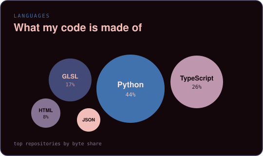
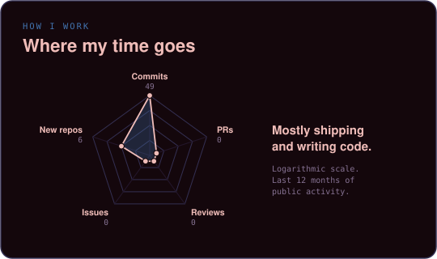

<p align="center">
  
</p>

<p align="center">
  <a href="https://www.linkedin.com/in/vlad-holoven-a5521737a/"></a></a>
  <a href="https://www.behance.net/fa91f899"></a>
</p>

<p align="center">
  
  
</p>

---

### Selected Work

| Project | Description | Stack |
| :--- | :--- | :--- |
| **UI/UX Local Base** | Local interface auditing database and testing checklist built on M3 and WCAG standards | `M3` `WCAG` `UI/UX` |
| **Local Meet** | Location-based community meetup and event discovery interface with mobile-first navigation | `Figma` `UI/UX` `Prototyping` |
| **Incident App** | Incident reporting and status-tracking interface focused on rapid input and visual hierarchy | `Figma` `Design System` `UI/UX` |

---

### Now

```text
> building : UI/UX Local Base — structured M3 & WCAG interface auditing database
> focus    : ui/ux systems / accessibility / product interfaces
> location : Poland
```
